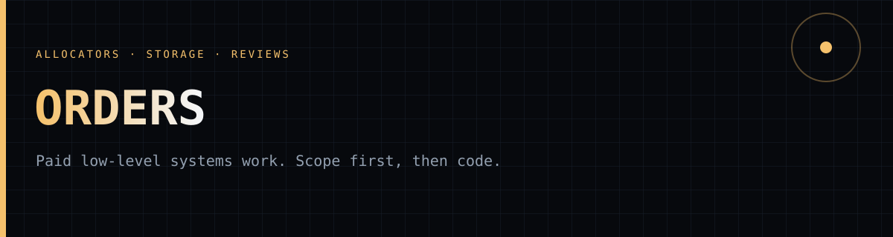

<p align="center">
  
</p>

# Orders

I accept paid orders for low-level systems work.

### What I take
- Custom lock-free allocators
- Deterministic memory systems
- High-performance storage engines (WAL etc.)
- Architecture reviews
- Private audits

### How to order
1. Open an issue in this repository with a short description
2. Or DM me on X
3. We agree on scope and price
4. Payment in ETH / USDC

Looking forward to clear and technical requests.

### Check a brief

`brief.py` reads a text brief and checks four required fields: `title`, `language`, `deadline`, `budget`. Each must be present and non-empty. It does not take payment and it does not talk to a network.

```bash
python3 brief.py --title "lock-free allocator" --language C --deadline 2026-12-01 --budget "2 ETH"
python3 brief.py <<'EOF'
title: WAL engine
language: Rust
deadline: 2026-08-01
budget: 1000 USDC
EOF
python3 brief.py selftest
```

Exit 0 when the brief is complete. Exit 2 when a field is missing or blank; the program prints which one (`missing: deadline`).
